# memdiag

**Find where your agent's memory fails, in the logs you already have.**



memdiag reads an agent's conversation logs and reports each memory failure at the turn it happened,
next to the earlier turn it contradicts, quoted word for word:

```
STALE_FACT · retrieve · confidence 1.00 · u1 · user.city
  user, turn 4    "we relocated to Austin"
  agent, turn 7   "Try Mount Falcon Park, about 30 minutes from Denver."
```

This is real output from `memdiag run examples/walkthrough.jsonl --model qwen2.5:7b` (the demo above is
regenerated from the same commands by `scripts/make_demo_svg.py`). The log is a synthetic 4-call example.
The memory the agent got said "Denver", so the fact was never retrieved.

- **No ground truth needed.** The reference is what each user actually said, rebuilt from the log.
- **Works with any memory setup.** Built-in context, Mem0, Zep, a vector store: memdiag only needs the
  messages, plus (optionally) the memory context each call received.
- **Says where it broke.** With the memory context logged, every failure is labelled **retrieve** (memory
  never supplied the fact) or **use** (the model had it and ignored it).
- **Runs locally.** Rules by default, with zero dependencies. Add a local open-source model (Ollama) to read
  any fact. No API key needed.

```bash
pip install .                              # no dependencies
memdiag demo                               # synthetic example
memdiag run your_logs.jsonl                # writes findings.jsonl and report.html
memdiag run your_logs.jsonl --model qwen2.5:7b   # local LLM mode (ollama serve; ollama pull qwen2.5:7b)
```

The report puts each failing turn next to its evidence. See
[`examples/findings_report.html`](examples/findings_report.html) for the demo's report.

## Validation so far

Goal 1 injects one known memory failure into clean LongMemEval conversations and checks that memdiag reports it
at the right turn. Each injection has a look-alike control. The targets were pre-registered, and the numbers
below are held-out (templates and conversations the detectors were never tuned on). Full method, intervals and
misses: [docs/validation.md](docs/validation.md).

| Held-out | Rules only (200 cases) | Local LLM, qwen2.5:7b (64 cases) | Target |
|---|---|---|---|
| Stale facts | 0.16 | 0.62 | ≥ 0.85 |
| Re-asked facts | 0.24 | 0.88 | ≥ 0.85 |
| Dropped instructions | 1.00 | 1.00 | ≥ 0.85 |
| User repairs | 1.00 | 1.00 | ≥ 0.85 |
| False positives | 0 / 100 | 0 / 32 | ≤ 0.05 |

**Goal 1 is not met yet.** Stale-fact recall misses in LLM mode: the 7B judge rejected correct candidates.
The LLM sample is small, and agreement with real labels and humans (Goal 2) hasn't been measured.
**In progress (M6b):** a stale-fact judge policy chosen on dev data only, new decoy controls the judge must
reject, then the full held-out LLM run and rerun stability, published next to these numbers. The
injected failures are explicit, so treat these numbers as an upper bound for real logs. Read the quotes, not
just the scores.

## Input

`traces.jsonl`: one message per line.

```json
{"user_id": "maya", "session_id": "m3", "ts": "2026-03-02T12:00:06", "role": "assistant",
 "content": "Since you live in Seattle, BECU is a popular credit union near you.",
 "retrieved": [{"id": "doc_platinum", "text": "..."}], "context_tokens": 2600}
```

`retrieved` (RAG documents), `memory` (memory context injected into the call) and `context_tokens` are optional.
`docs.jsonl` (optional) is your knowledge base: `{"id": ..., "text": ...}`.

memdiag also reads these formats directly; the format is detected from the file (or pass `--format`):

| `--format` | Shape |
|---|---|
| `events` | the JSONL above, one message per line |
| `openai` | one conversation per line: `{"user_id": ..., "session_id": ..., "messages": [{"role": ..., "content": ...}]}`. System and tool messages are skipped, and missing timestamps are filled in order. |
| `longmemeval` | LongMemEval items (JSON list). Each item becomes one user, with its haystack sessions and the final question. |

Every finding records the turn it failed on, the earlier turn it contradicts, and verbatim quotes from
both (`failing_turn`, `evidence_turns`, `failing_quote`, `evidence_quote`), so you can jump straight to it.

## Local LLM mode

Rules alone are fast and free, but they only read a few attributes. Add a local open-source model to
extract any fact the user states and to confirm candidates:

```bash
ollama serve & ollama pull qwen2.5:7b
memdiag run traces.jsonl --model qwen2.5:7b           # any OpenAI-compatible endpoint: --base-url
memdiag ledger traces.jsonl --model qwen2.5:7b        # what memdiag thinks each user said
```

Every model call is cached in `.memdiag_cache`, so reruns are free. If your log includes the memory
context injected into each call (`"memory": [{"id": ..., "text": ...}]`), each failure is also located:
**retrieve** means the memory never gave the model the fact, and **use** means it did and the model ignored it.

## Scores

Alongside the findings, every run produces normalized memory metrics (`memory_faithfulness`,
`fact_currency`, `deletion_compliance`, `user_isolation`, `groundedness`, `recall_continuity`,
`constraint_retention`).
Each is `1 - failures / opportunities`, reported with its counts, and `n/a` when the agent never
had a chance to fail. Definitions: [docs/metrics.md](docs/metrics.md). Use them as a CI gate:

```bash
memdiag diagnose traces.jsonl --fail-under deletion_compliance=1.0 --fail-under user_isolation=0.99
```

## What it detects

| Class | Failure | How it's detected |
|---|---|---|
| Memory | Stale memory | Agent asserts a value the user later updated |
| Memory | Failed deletion | Agent uses a fact after the user asked to forget it |
| Memory | Cross-user leak | Agent asserts a value that belongs to a different user |
| Memory | Invented memory | Agent asserts a user fact nobody ever stated |
| Memory | Forgotten memory | Agent asks again for a fact the user already gave |
| Memory | Dropped instruction | Agent breaks a standing instruction the user gave earlier (word limit, language, no bullets, banned word, no emoji) |
| Retrieval | Ignored context | Agent's answer contradicts a document it retrieved |
| Retrieval | Retrieval miss | Agent was unsure or the user pushed back, and a better document existed but wasn't retrieved |
| Context | Context overload | A failure happened with a very large context window (tagged) |
| Unknown | Unattributed | User pushed back and no rule explains it |

User pushback ("that's wrong", "I asked you to forget") and repairs ("I already told you") are reported as
signals: they point at the agent turn before them, but aren't scored on their own.

## How it differs

- **LLM-judge memory metrics** score a conversation: AWS's UAEF `context_retention` asks a judge for one
  0-1 rating, and DeepEval's KnowledgeRetention counts the assistant turns a judge flags for forgetting.
  memdiag reports each failure at its turn, with the earlier turn it contradicts quoted verbatim. It also
  tracks facts the user later updated or asked to forget, works across sessions and users, and separates
  retrieve from use failures.
- **Memory benchmarks** (LongMemEval, LoCoMo) need gold questions and answers. memdiag needs only your
  production logs, and rebuilds the reference from what each user actually said.
- **Validation first.** Detectors are scored against pre-registered targets on held-out data, and misses are
  published. See [docs/validation.md](docs/validation.md).

## Strategy replay (`memdiag diagnose`)

`memdiag diagnose` adds a strategy replay on top of the findings.

Candidate strategies today: no memory, full history in context, top-k search (per user and shared index), latest-value profile, and profile with deletion. Real backends plug in by implementing `MemoryBackend` (`add`, `recall`) in `memdiag/strategies.py` and replaying the same history.

## MCP server

```bash
pip install ".[mcp]"
memdiag-mcp            # stdio server with tools diagnose_traces and diagnose_report
```

## Limits

- Rules mode reads location, employer, income, loans and credit score. `--model` reads any fact, but a 7B
  judge misses things: rules decide where they fire, and the judge only adds or confirms findings.
- A failure that leaves no trace in the reply is invisible. Every report has a "what this report can't see"
  section, so silence isn't mistaken for good memory.
- The demo data is synthetic, and the experiment samples are tiny. Neither is a benchmark.
- Vendor adapters (Zep, Mem0, graph stores) are not built yet. Log the injected memory as `memory` on each call instead.
- memdiag tracks what the *user* said. An agent contradicting its own earlier answer isn't detected yet.

## Status and roadmap

memdiag is pre-release (no PyPI package yet; install from source). Done: localized findings, the fact
ledger, a local judge, `memdiag run`, and the Goal 1 harness. Next: the M6b stale-fact fix, agreement with
real labels and human audit (Goal 2), then integrations (OpenTelemetry, Langfuse, a pytest assertion) and
v0.2.0. Plan and success criteria: [docs/ROADMAP.md](docs/ROADMAP.md).

### Known failure on unseen phrasing

`examples/unseen_phrasing.jsonl` contains two real memory failures (a stale city and a stale employer) that rules mode misses, because the user says "we relocated to" and "I left Target for a role at REI". When extraction misses an update, the strategy replay is graded against an incomplete timeline and can overrate strategies like full history. `tests/test_known_limits.py` records this as expected failures; `--model` is the fix.
